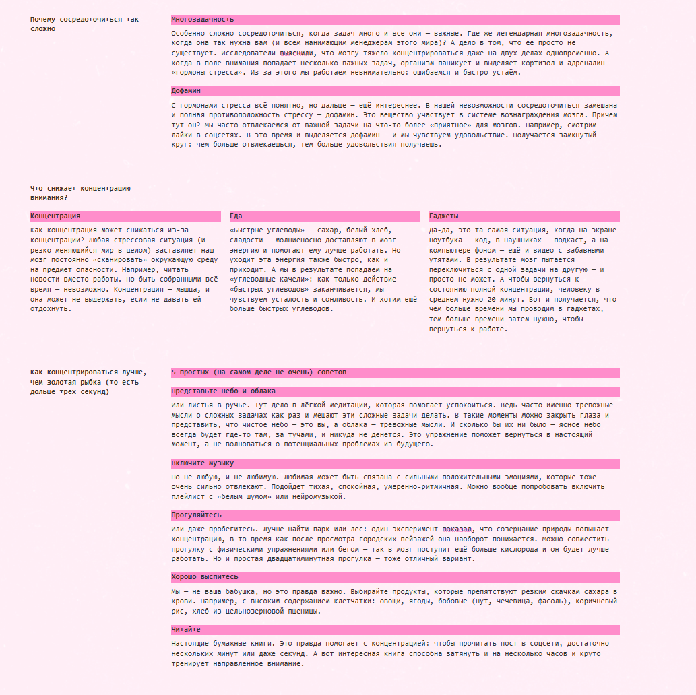
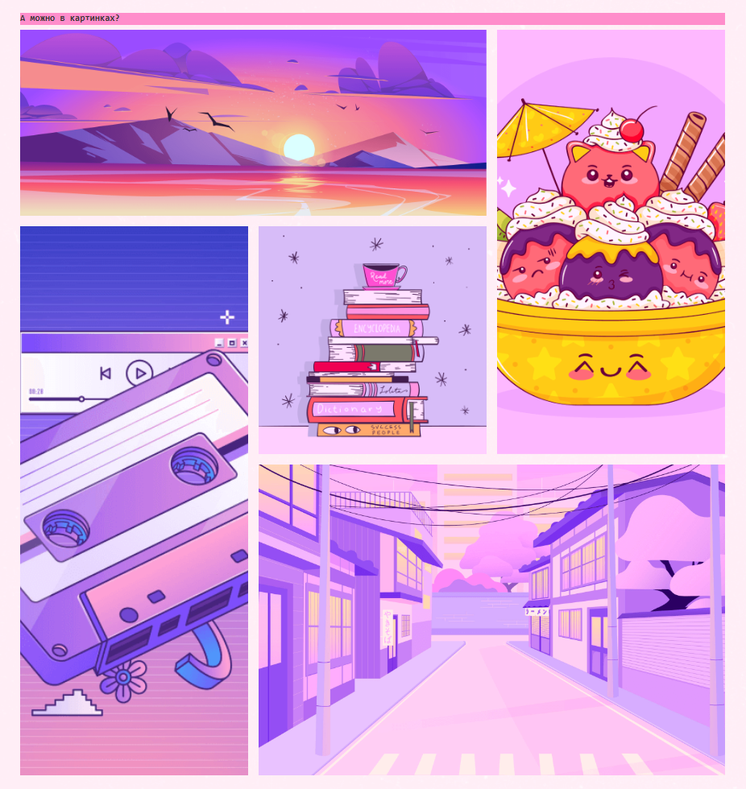
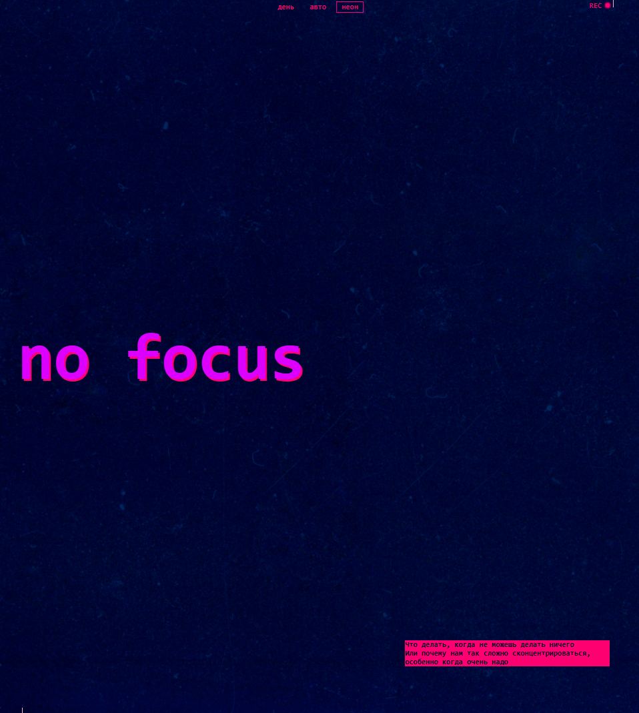

https://github.com/HighBlueJameveu/slozhno-sosredotochitsya-ad.git

 В процессе работы был создан сайт, имеющий свою версию для теелфонов планшетов и пк, для этого были использованы CSS-переменные которые обеспечили три темы День/Авто/Неон без дублирования кода, а мобильная вёрстка под 320px стала базой, от которой через @media наращивались планшетная и десктопная версии. Ключевую роль сыграли CSS Grid с grid-template-areas для галереи, clamp() для плавного масштабирования заголовков, flexbox для карточек и псевдоэлементы ::before/::after для декоративных уголков и индикатора REC — всё это позволило обойтись без JS-логики вёрстки и сделать сайт полностью адаптивным и темизируемым.

